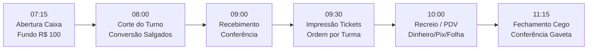

# Roteiro de Demonstração Operacional — Cantina Web
**Colégio Monteiro Lobato — Apresentação ao Operador da Cantina**

Este roteiro foi desenhado para guiar a apresentação completa do sistema ao **operador da cantina**, demonstrando como o sistema automatiza e simplifica o dia a dia escolar, eliminando erros manuais, filas, conferências no papel e riscos com alergias alimentares.

---

## 🔑 Credenciais Prontas para Demonstração

| Perfil | Acesso / Identificador | Senha | O que demonstrar |
| :--- | :--- | :--- | :--- |
| **Operador da Cantina** | `operador-maria` ou `operador` | `Operador@123` | Caixa, Corte de Salgados, Recebimento, Tickets Térmicos, PDV Balcão e Estoque |
| **Administrador Geral** | `admin` | `Admin@123` | Cardápio, Importação NF-e XML, Cadastro de Turmas, Relatórios Gerenciais e Folha RH |
| **Portal da Família (Mãe)** | CPF: `123.456.789-09` | `Familia@123` | Saldo Familiar, Recarga Pix, Agendamento de Lanches e Alertas de Alergias |
| **Família (Primeiro Acesso)** | CPF: `999.888.777-66` | *(Ativação)* | Fluxo de Primeiro Acesso via código WhatsApp |

---

## 🕒 Cronograma da Demonstração (Um Dia Real na Cantina)



---

### ETAPA 1 — 07:15: Início do Turno & Abertura de Caixa
> **Objetivo:** Mostrar como o operador inicia o dia registrando o fundo de troco na gaveta.

1. **Acessar:** `http://localhost:8080/login`
2. **Entrar:** Selecione a aba **Equipe da Cantina**, digite `operador-maria` e senha `Operador@123`.
3. **Navegar:** Menu Lateral ➔ **Caixa do Turno** (`/operacional/caixa`).
4. **O que mostrar ao operador:**
   - O caixa do turno matutino já está **ABERTO** com **R$ 100,00** de fundo de troco.
   - Mostre os cartões de faturamento dinâmico em tempo real:
     - *Fundo Inicial:* R$ 100,00
     - *Vendas em Dinheiro:* R$ 27,50
     - *Vendas via Pix:* R$ 14,00
     - *Total Esperado na Gaveta:* R$ 127,50
   - Destaque o histórico inferior: exibe as sessões de caixa anteriores já conferidas e fechadas com comprovante.

---

### ETAPA 2 — 08:00: Corte do Turno & Encomenda ao Fornecedor
> **Objetivo:** Mostrar o fechamento dos agendamentos da manhã e a conversão inteligente de salgados pequenos em salgados grandes!

1. **Navegar:** Menu Lateral ➔ **Corte do Turno** (`/operacional/corte`).
2. **O que destacar:**
   - **Regra de Horário:** Às 08:00 ocorre o corte automático dos pedidos matutinos.
   - **A Grande Novidade dos Salgados Fracionados:**
     - Mostre que os alunos pediram no total **15 Coxinhas Pequenas**.
     - O sistema calcula automaticamente: $15 \div 2 =$ **7 Coxinhas Grandes + 1 Pequena**!
     - Na tabela do fornecedor aparece consolidado exatamente:
       - `Coxinha de Frango Grande`: **7 unidades**
       - `Coxinha de Frango pequena`: **1 unidade**
       - **Total de peças físicas a produzir/entregar:** **8 peças**!
   - **Botão "Copiar para WhatsApp":**
     - Clique no botão verde de cópia.
     - Mostre a mensagem pronta copiada para a área de transferência:
       ```text
       *COLÉGIO MONTEIRO LOBATO — CANTINA ESCOLAR*
       *PEDIDO DE SALGADOS — CORTE DO TURNO*

       📅 Data de Consumo: 28/09/2026
       ⏰ Turno: Matutino

       • 7x Coxinha de Frango Grande (SAL-002-G)
       • 1x Coxinha de Frango pequena (SAL-002-P)
       • 2x Suco de Laranja Natural 300ml (SUC-001)
       • 1x Suco de Uva Integral 300ml (SUC-002)
       • 1x Misto Quente Tradicional (LAN-002)
       • 1x Sanduíche Natural de Frango (LAN-001)
       • 1x Salada de Frutas Frescas (SOB-001)

       TOTAL GERAL: 14 peças
       ```
   - **Botão "Imprimir Relatório (A4)":** Mostre o espelho formal timbrado pronto para impressão ou download em PDF.

---

### ETAPA 3 — 09:00: Chegada do Fornecedor & Conferência de Recebimento
> **Objetivo:** Mostrar a conferência física quando o entregador dos salgados chega à escola.

1. **Navegar:** Menu Lateral ➔ **Recebimento de Salgados** (`/operacional/recebimento`).
2. **O que destacar:**
   - A tela lista exatamente as peças esperadas calculadas no corte.
   - O operador digita o que o fornecedor realmente entregou nas bandejas.
   - Se faltar ou sobrar alguma unidade, o sistema apura a diferença linha a linha (`Exato`, `Sobra` ou `Falta`) e gera a entrada física real no estoque.

---

### ETAPA 4 — 09:30: Impressão Térmica de Tickets por Turma com Alerta de Alergias
> **Objetivo:** Demonstrar a separação dos lanches por turma e a proteção contra alergias alimentares.

1. **Navegar:** Menu Lateral ➔ **Impressão de Tickets** (`/operacional/tickets`).
2. **O que destacar ao operador:**
   - **Ordem de Impressão Escolar:** Os tickets são emitidos sequencialmente pela ordem de entrega das turmas:
     1. **3º Ano A:** Sofia Ribeiro (`Sanduíche Natural` + `Salada de Frutas`)
     2. **5º Ano A:** Lucas Ribeiro (`Coxinha de Frango pequena` + `Suco de Laranja`)
     3. **7º Ano A:** Pedro Santos (`Coxinha de Frango pequena` + `Suco de Uva`)
     4. **9º Ano A:** Gabriel Almeida (`Misto Quente` + `Suco de Laranja`)
   - **Blindagem de Alergias Alimentares (Tags em Amarelo/Âmbar):**
     - Mostre o destaque visual nos tickets:
       - Lucas Ribeiro tem restrição a **Glúten**.
       - Sofia Ribeiro e Gabriel têm restrição a **Lactose**.
       - Pedro Santos tem restrição a **Amendoim**.
     - O operador visualiza no ticket exatamente a restrição do aluno antes de colocar o lanche na cesta da turma!
   - **Botões de Emissão:**
     - **"Imprimir em Lote (Bobina 80mm)"**: gera o cupom contínuo térmico para destacar ticket por ticket.
     - **"Segunda Via de Ticket"**: se um aluno perder o ticket no pátio, o operador pode reemitir a 2ª via informando o motivo, com registro automático na auditoria.

---

### ETAPA 5 — 10:00: Operação do Recreio & PDV de Balcão
> **Objetivo:** Mostrar a agilidade nas vendas presenciais no balcão da cantina durante o intervalo.

1. **Navegar:** Menu Lateral ➔ **PDV / Balcão** (`/operacional/pdv`).
2. **Demonstrar os 3 Casos de Uso:**
   - **Caso 1: Venda Avulsa em Dinheiro com Cálculo de Troco**
     - Selecione: 1 Biscoito Cookie (R$ 4,50) + 1 Suco de Uva (R$ 7,00) = R$ 11,50.
     - Forma de Pagamento: `Dinheiro`.
     - Digite no campo "Valor Recebido": `20,00`.
     - Mostre o visor calculando automaticamente: **Troco a Devolver: R$ 8,50**.
     - Finalize a venda.
   - **Caso 2: Venda Avulsa via Pix no Balcão**
     - Selecione 1 Coxinha Grande (R$ 8,00).
     - Forma de Pagamento: `Pix Balcão`.
     - Mostre a confirmação instantânea da venda.
   - **Caso 3: Professor / Colaborador com Desconto em Folha de Pagamento**
     - Clique na aba/seletor **"Desconto em Folha (Colaborador)"**.
     - Selecione o **Prof. Roberto Silva** ou **Profa. Juliana Mendes**.
     - Mostre que o sistema exibe a **foto**, o **cargo** e a **matrícula funcional** (`COL-1001`) para conferência visual.
     - Registre o lanche: nenhum centavo é cobrado em espécie na hora; o valor é computado diretamente na folha de pagamento do colaborador!

---

### ETAPA 6 — 11:15: Fechamento Cego de Caixa & Prestação de Contas
> **Objetivo:** Mostrar a segurança e transparência do fechamento de turno sem que o operador saiba o total antes de contar.

1. **Navegar:** Menu Lateral ➔ **Caixa do Turno** (`/operacional/caixa`).
2. **O que destacar:**
   - Clique em **"Fechar Caixa do Turno"**.
   - **Conferência Cega:** O operador não vê quanto o sistema espera em dinheiro na gaveta. Ele conta o dinheiro físico e digita o valor contado.
   - Ao confirmar, o sistema faz o cruzamento:
     - Se o valor for idêntico: **Diferença: R$ 0,00 (Exato)**.
     - Se faltar dinheiro: aponta Quebra de Caixa.
     - Se sobrar: aponta Sobra de Caixa.
   - **Espelho de Prestação de Contas:** Emite relatório para impressão A4 ou térmico com os campos para assinatura do Operador e do Gerente da Cantina.

---

### ETAPA 7 — Controle de Estoque & Alerta de Reposição
> **Objetivo:** Mostrar como o operador monitora o estoque e evita faltar mercadoria.

1. **Navegar:** Menu Lateral ➔ **Estoque** ➔ **Visão Geral** (`/estoque`).
2. **O que destacar:**
   - **Alerta de Estoque Mínimo Ativo:**
     - Observe o produto `Água Mineral sem Gás 500ml` (código `BEB-001`).
     - Estoque Atual: **4 unidades** | Estoque Mínimo: **10 unidades**.
     - O sistema exibe o badge de atenção, alertando que é necessário fazer pedido de reposição antes que o produto esgote.
   - **Histórico de Movimentações:** Mostra todas as entradas e saídas detalhadas.
   - **Importação de NF-e XML (`/estoque/xml`):** Mostre como a nota fiscal eletrônica enviada pela distribuidora converte caixas em unidades automaticamente, sem digitação manual de notas.

---

### ETAPA 8 — Visão dos Pais: O Portal da Família
> **Objetivo:** Mostrar ao operador como as famílias usam o sistema para colocar saldo e agendar os lanches de casa.

1. **Deslogar:** Clique em **Sair** no menu lateral.
2. **Acessar:** `http://localhost:8080/login` na aba **Portal da Família**.
3. **Entrar:** CPF `12345678909` e senha `Familia@123` (Mariana Ribeiro).
4. **O que demonstrar:**
   - **Saldo Único Compartilhado:** Saldo atual de R$ 120,00 compartilhado entre seus dois filhos (Lucas e Sofia).
   - **Recarga Pix Dinâmica (`/portal/carteira`):**
     - Digite R$ 50,00 e clique em "Gerar Pix".
     - O sistema gera instantaneamente o QR Code e o código Copia e Cola.
     - O saldo cai na conta familiar na hora via Webhook bancário.
   - **Agendamento Semanal (`/portal/agendamento`):**
     - O responsável escolhe o dia da semana e o lanche de cada filho.
     - **Proteção Preventiva de Alergia:** Se a mãe tentar pedir um lanche com Glúten para o Lucas, o sistema emite um alerta corporativo destacando os alérgenos presentes para confirmação consciente.
   - **Gestão Ativa de Alergias (`/portal/alergias`):**
     - A mãe pode marcar e atualizar as restrições alimentares dos filhos a qualquer momento.

---

### ETAPA 9 — Relatórios Gerenciais (Visão Administrativa)
> **Objetivo:** Mostrar à gerência e ao operador como as informações financeiras e contábeis são consolidadas.

1. **Entrar como Administrador:** `admin` / `Admin@123`.
2. **Navegar:** Menu Lateral ➔ **Hub de Relatórios** (`/relatorios`).
3. **Relatórios Prontos para Apresentar:**
   - **Desconto em Folha para RH (`/relatorios/desconto-folha`):**
     - Tabela consolidada com todos os professores e funcionários que consumiram no mês.
     - Botão **"Exportar CSV para RH"** (importação no sistema de folha de pagamento).
     - Botão **"PDF Individual"** com recibo discriminado para o professor assinar.
   - **Vendas por Alimento & Curva ABC (`/relatorios/vendas-alimento`):**
     - Ranking dos itens mais vendidos, faturamento por produto e classificação A, B ou C.
   - **Extrato Analítico do Aluno (`/operacional/extrato-aluno`):**
     - Digite "Lucas" e veja todo o histórico de recargas e consumo linha a linha para prestar contas aos pais em segundos.

---

## 💡 Dicas de Sucesso para a Apresentação

1. **Foque na Economia de Tempo:** Mostre como o botão *"Copiar para WhatsApp"* substitui 20 minutos de anotações no papel todas as manhãs.
2. **Ressalte a Segurança:** Destaque que os tickets com alérgenos protegem a escola e a cantina contra acidentes com alunos alérgicos.
3. **Mostre a Simplicidade do PDV:** No recreio a fila precisa andar rápido; no PDV são necessários apenas 2 cliques para vender em dinheiro com troco ou no Pix.
4. **Demonstre o Desconto em Folha:** Explique que o operador não precisa mais ter caderneta de anotação de professores; tudo é auditado e faturado direto com o RH.
5. **Pergunte ao Operador:**
   - *"Essa tela de corte com os salgados agrupados atende a como você pede para o fornecedor?"*
   - *"A ordem das turmas nos tickets facilita a entrega nas salas ou cestas?"*
   - *"O fluxo de caixa cego está claro para a sua conferência no fim do turno?"*
